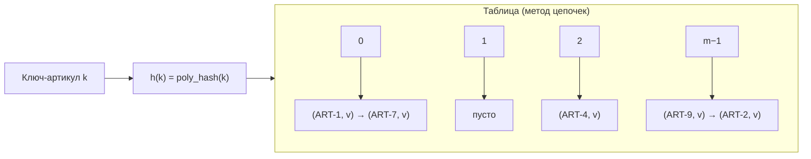

# Лабораторная работа № 5

**МИНИСТЕРСТВО НАУКИ И ВЫСШЕГО ОБРАЗОВАНИЯ**  
**РОССИЙСКОЙ ФЕДЕРАЦИИ**

Федеральное государственное бюджетное образовательное учреждение  
высшего образования  
«______________________________»

Кафедра ________________________________

---

# ЛАБОРАТОРНАЯ РАБОТА № 5

по дисциплине «Основы алгоритмизации и программирование»

Хеширование и экспериментальное исследование методов разрешения коллизий

## Вариант 6

| | |
|---|---|
| Направление | 38.03.05 «Бизнес-информатика» |
| Курс | 2 |
| Выполнил | студент группы БИ 2-1 |
| ФИО | Голдаева Валерия Валентиновна |
| Проверил | ___________________________ |
| Год | 2026 |

---

## 1. Цель работы и формулировка задания

**Цель работы:** изучить принципы хеширования как способа организации данных с временем доступа $O(1)$ в среднем, реализовать хеш-таблицу и экспериментально исследовать влияние хеш-функции и коэффициента заполнения на её производительность.

**Задание варианта 6:**

| Параметр | Значение |
|---|---|
| Тип ключей | Строки (артикулы вида `ABC-12345`) |
| Хеш-функция | **П** — полиномиальная для строк |
| Разрешение коллизий | **Ц** (метод цепочек) и **Дв** (двойное хеширование) |
| Число элементов $n$ | $30\,000$ |
| Размер таблицы $m$ | $49\,999$ (простое) |
| Коэффициент $\alpha$ | $n/m \approx 0{,}600$ |
| Доп. задание | **В6** — кластеризация при линейном пробировании |

---

## 2. Описание хеш-функции и способов разрешения коллизий

### 2.1. Полиномиальное хеширование строк

$$
h(s) = \Bigl(\sum_{i=0}^{L-1} s_i \cdot p^{\,i}\Bigr) \bmod m,\quad p = 31.
$$

Результат зависит от **всех** символов ключа → равномерное распределение по ячейкам. Размер $m$ — простое число (49 999).

**Плохой пример** (для сравнения): $h(s) = \mathrm{ord}(s[0]) \bmod m$ — учитывает только первый символ, даёт ~26 различных значений.

### 2.2. Метод цепочек

Все элементы с одинаковым $h(k)$ хранятся в связном списке у соответствующей ячейки. Допускается $\alpha > 1$. Средняя трудоёмкость поиска $\Theta(1+\alpha)$.

### 2.3. Двойное хеширование (открытая адресация)

Последовательность проб:

$$
\mathrm{pos}_i = \bigl(h_1(k) + i \cdot h_2(k)\bigr) \bmod m.
$$

$h_2$ выбирается ненулевым и взаимно простым с $m$. Обязательно $\alpha < 1$. Среднее число проб при неуспехе $\approx 1/(1-\alpha)$.

### 2.4. Линейное пробирование (для В6)

$\mathrm{pos}_i = (h(k)+i)\bmod m$. Вызывает **первичную кластеризацию** — длинные занятые участки, на которых новые ключи с высокой вероятностью «прилипают».

---

## 3. Схема структуры данных



**Двойное хеширование:** элементы хранятся прямо в массиве; при занятости ячейки берётся следующая по формуле $h_1 + i\cdot h_2$.

---

## 4. Листинг программы с подробными комментариями

Полный код: `lab5-variant6/main.py`.

### 4.1. Полиномиальный хеш

```python
def poly_hash(key, m=M, p=31):
    h = 0          # накопленная сумма
    pw = 1         # текущая степень p^i
    for ch in key:
        # вклад i-го символа: ord(ch) * p^i
        h = (h + ord(ch) * pw) % m
        pw = (pw * p) % m   # переход к p^{i+1}
    return h
```

### 4.2. Метод цепочек — вставка

```python
def insert(self, key, value):
    idx = self.hash_fn(key, self.m)   # индекс ячейки
    chain = self.slots[idx]
    for i, (k, _) in enumerate(chain):
        self.probes += 1              # счётчик сравнений
        if k == key:
            chain[i] = (key, value)   # обновление
            return
    chain.append((key, value))        # новый элемент в конец цепочки
    self.n += 1
```

### 4.3. Двойное хеширование — вставка

```python
def insert(self, key, value):
    pos = self._h1(key)               # стартовая позиция
    step = self._h2(key)              # шаг (≠ 0)
    for _ in range(self.m):
        self.probes += 1
        k = self.keys[pos]
        if k is self.EMPTY or k is self.DELETED:
            self.keys[pos] = key      # свободная ячейка
            self.values[pos] = value
            self.n += 1
            return
        if k == key:
            self.values[pos] = value  # обновление
            return
        pos = (pos + step) % self.m   # следующая проба
    raise RuntimeError('Таблица переполнена')
```

### 4.4. Кластеры при линейном пробировании (В6)

```python
def cluster_lengths(self):
    occupied = [k is not self.EMPTY for k in self.keys]
    lengths, current = [], 0
    for flag in occupied + [False]:
        if flag:
            current += 1
        elif current:
            lengths.append(current)
            current = 0
    # кольцевой кластер (конец + начало массива)
    if occupied[0] and occupied[-1] and len(lengths) >= 2:
        lengths[0] += lengths[-1]
        lengths.pop()
    return lengths
```

---

## 5. Характеристики вычислительной системы

| Параметр | Значение |
|---|---|
| ОС | Linux |
| Язык | Python 3.12 |
| Таймер | `time.perf_counter()` |
| Запросов на поиск | 10 000 (успешные) |

---

## 6. Результаты измерений

### 6.1. Основной эксперимент ($n=30\,000$, $m=49\,999$, $\alpha=0{,}600$)

| Реализация | Вставка, с | Поиск, с | Проб на запрос |
|---|---:|---:|---:|
| Метод цепочек | 0,044 | 0,013 | 1,30 |
| Двойное хеширование | 0,094 | 0,024 | 1,52 |
| `dict` (эталон) | 0,003 | 0,001 | — |

**Цепочки:** max длина = 6, пустых ячеек = 27 331 из 49 999 (55 %), средняя длина = 0,600 (= α).

Теория для успешного поиска при открытой адресации: $\frac12\bigl(1+\frac1{1-\alpha}\bigr) \approx 1{,}75$ при $\alpha=0{,}6$; измеренное 1,52 — того же порядка.

### 6.2. Качественная vs плохая хеш-функция

| Функция | Ненулевых ячеек | Макс. в одной ячейке |
|---|---:|---:|
| `poly_hash` | 22 668 | 6 |
| `bad_hash` (1-й символ) | 26 | 1 215 |

Плохая функция «сваливает» почти все ключи в ~26 ячеек → поиск деградирует до линейного.

### 6.3. Доп. задание В6 — кластеризация при линейном пробировании

| $\alpha$ | Число кластеров | Макс. длина | Средняя длина |
|---:|---:|---:|---:|
| 0,3 | 9 071 | 12 | 1,65 |
| 0,5 | 9 942 | 37 | 2,51 |
| 0,7 | 7 537 | 91 | 4,64 |
| 0,9 | 2 932 | 440 | 15,35 |

При росте $\alpha$ кластеры сливаются: их число падает, а максимальная и средняя длины резко растут. Это и есть **первичная кластеризация** — причина, по которой линейное пробирование хуже двойного хеширования при больших $\alpha$.

### 6.4. Графики

- `plot_probes_alpha.png` — число проб vs α (теория + измерения)
- `plot_clusters.png` — кластеры при линейном пробировании
- `plot_hash_quality.png` — poly vs bad

---

## 7. Выводы

1. При $\alpha \approx 0{,}6$ обе реализации (цепочки и двойное хеширование) обеспечивают поиск за 1,3–1,5 пробы — согласуется с теорией $\Theta(1+\alpha)$.
2. Метод цепочек устойчивее: число проб растёт линейно по $\alpha$; при открытой адресации — как $1/(1-\alpha)$, резко у $\alpha\to 1$.
3. Полиномиальный хеш даёт равномерное распределение (max цепочка 6); хеш по первому символу — катастрофические коллизии (max 1215).
4. **В6:** при линейном пробировании с ростом $\alpha$ кластеры укрупняются (max длина 12 → 440), что подтверждает первичную кластеризацию.
5. Встроенный `dict` быстрее (реализация на C, тонкие оптимизации); собственная таблица нужна для наблюдения внутренних метрик (пробы, длины цепочек/кластеров).

---

*Конец отчёта*
